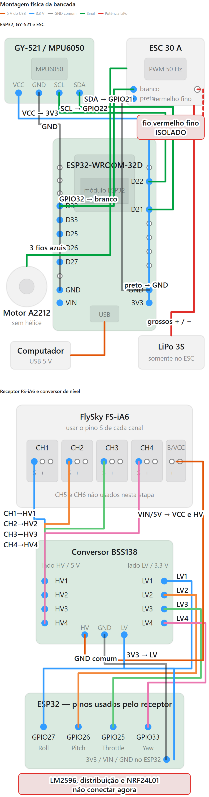

# Drone experimental com ESP32

Projeto de estudo para desenvolver, por etapas, um controlador de voo baseado no ESP32-WROOM-32D. O estágio atual é exclusivamente de bancada: leitura da unidade inercial, recepção dos comandos do rádio, validação das rotinas de segurança e acionamento limitado de um único ESC e motor sem hélice.

O firmware produz PWM para somente um ESC no GPIO32. A saída física só é habilitada no estado `BENCH_ARMED` e está limitada por software à faixa de 1.000 a 1.100 µs. Um movimento deliberado acima de 4% do throttle aplica o pulso inicial de 1.070 µs; depois disso, a subida é gradual. A redução e a parada são imediatas. Essa configuração serve apenas para testes controlados de bancada e ainda não constitui um controlador de voo.

## Segurança

- Remova todas as hélices antes de qualquer teste de bancada.
- Mantenha a bateria LiPo desconectada durante montagem, programação e conferência das ligações.
- Nunca conecte a bateria LiPo diretamente ao ESP32, ao receptor ou ao GY-521.
- Use o LM2596 somente depois de ajustar e confirmar sua saída com um multímetro.
- O ESC usa alimentação própria pela LiPo; ESP32 e receptor permanecem alimentados pelo USB nesta etapa.
- A saída atual controla somente um motor e possui limite rígido de 1.100 µs.
- Este protótipo ainda não está pronto para voo.

## Objetivo inicial

Construir uma base confiável para:

1. ler e calibrar o MPU6050;
2. receber os quatro canais principais do FlySky FS-i6;
3. detectar perda ou corrupção do sinal do receptor;
4. converter os comandos do rádio para valores normalizados;
5. validar com segurança a saída para um ESC antes de implementar mixer e controle PID.

## Etapa validada em bancada

O firmware atual já executa:

- detecção do MPU6050 nos endereços I2C `0x68` ou `0x69`;
- validação do registrador `WHO_AM_I`;
- acelerômetro configurado para ±4 g;
- giroscópio configurado para ±500 graus/s;
- calibração inicial do giroscópio com 1.000 amostras;
- leitura da IMU a 200 Hz;
- estimativa de roll e pitch por filtro complementar;
- leitura simultânea dos canais CH1, CH2, CH3 e CH4 por interrupções;
- rejeição de pulsos fora da faixa de 900 a 2.100 microssegundos;
- confirmação de mudanças grandes em dois quadros consecutivos;
- failsafe após 100 ms sem pulso válido;
- comandos normalizados de roll, pitch, throttle e yaw;
- telemetria no monitor serial a 10 Hz;
- leitura da IMU, do receptor e normalização dos comandos separadas em módulos;
- módulo de segurança com armamento e desarmamento de bancada, temporizadores e bloqueio após failsafe;
- contadores cumulativos de pulsos rejeitados, failsafe e recuperação do receptor;
- PWM de 50 Hz para um ESC no GPIO32;
- faixa física limitada a 1.000–1.100 µs;
- partida em 1.070 µs quando o throttle ultrapassa 4%, com parada abaixo de 2%;
- rampa de subida limitada a 20 µs por segundo;
- redução de potência, desarme, failsafe e erro aplicados imediatamente em 1.000 µs.

## Materiais usados nesta etapa

- ESP32-WROOM-32D em placa de desenvolvimento;
- módulo GY-521 com MPU6050;
- rádio FlySky FS-i6;
- receptor FlySky FS-iA6;
- conversor de nível lógico BSS138 de quatro canais;
- protoboard e cabos de conexão;
- cabo USB para alimentação e programação;
- um ESC de 30 A;
- um motor A2212/6T 2200KV, testado sem hélice;
- bateria LiPo 3S 2.200 mAh para alimentação exclusiva do ESC.

Também estão disponíveis para etapas futuras os outros três motores e ESCs, a placa de distribuição e o conversor LM2596. Eles ainda não foram integrados.

## Diagrama de montagem



## Ligação do ESC e Motor 1

| ESC | Destino |
| --- | --- |
| fio fino branco, sinal | GPIO32 |
| fio fino preto, GND | GND do ESP32 |
| fio fino vermelho, BEC 5 V | isolado e não conectado |
| fios grossos vermelho e preto | bateria LiPo, somente durante o teste |
| três fios azuis | três fases do motor |

O sentido de rotação ainda não é definitivo. Para invertê-lo futuramente, basta trocar entre si dois dos três fios de fase, sempre com a bateria desconectada.

## Ligações do GY-521

| GY-521 | ESP32 |
| --- | --- |
| VCC | 3V3 |
| GND | GND |
| SDA | GPIO21 |
| SCL | GPIO22 |

O GY-521 está montado verticalmente nesta fase. Por isso, os ângulos exibidos servem para confirmar resposta e direção do sensor, mas ainda não representam a orientação de voo. Antes de implementar ou ajustar PID, o módulo deverá ser fixado horizontalmente e os eixos deverão ser validados novamente.

## Ligações do receptor e conversor de nível

O lado `HV` do conversor usa 5 V e recebe os sinais do receptor. O lado `LV` usa 3,3 V e envia os sinais ao ESP32. Todos os módulos precisam compartilhar o mesmo GND.

| Receptor FS-iA6 | Conversor | ESP32 |
| --- | --- | --- |
| CH1, pino S | HV1 → LV1 | GPIO27 |
| CH2, pino S | HV2 → LV2 | GPIO26 |
| CH3, pino S | HV3 → LV3 | GPIO25 |
| CH4, pino S | HV4 → LV4 | GPIO33 |
| 5V/VCC | HV | — |
| GND | GND comum | GND |
| — | LV | 3V3 |

O BSS138 funcionou nos testes de bancada. Para a instalação final, seu uso deverá ser reavaliado considerando integridade dos pulsos, comprimento dos fios e imunidade a ruído.

## Mapeamento do rádio

O FlySky FS-i6 está configurado em Mode 1. O mapeamento observado é:

| Canal | Comando | Controle físico |
| --- | --- | --- |
| CH1 | Roll | manche direito, horizontal |
| CH2 | Pitch | manche esquerdo, vertical |
| CH3 | Throttle | manche direito, vertical |
| CH4 | Yaw | manche esquerdo, horizontal |

Esse mapeamento é consequência do modo configurado no transmissor. Não se deve trocar CH2 e CH3 apenas para imitar Mode 2; qualquer mudança de modo deve ser feita conscientemente no rádio e depois validada novamente no firmware.

## Tratamento dos sinais do receptor

Cada canal é medido em microssegundos. O firmware:

- aceita somente pulsos entre 900 e 2.100 µs;
- ignora pulsos isolados fora dessa faixa;
- exige duas leituras consecutivas para confirmar uma variação grande;
- considera o receptor indisponível depois de 100 ms sem sinal válido;
- zera todos os comandos normalizados durante o failsafe.

Os campos normalizados são:

| Campo | Faixa |
| --- | --- |
| `roll_cmd` | -1,0 a +1,0 |
| `pitch_cmd` | -1,0 a +1,0 |
| `throttle_cmd` | 0,0 a 1,0 |
| `yaw_cmd` | -1,0 a +1,0 |

Roll, pitch e yaw possuem uma pequena zona morta ao redor do centro.

## Máquina de estados de bancada

A lógica de armamento controla a saída física limitada do Motor 1. Os estados são:

- `DISARMED`: estado inicial e seguro;
- `ARMING`: gesto de armamento sendo mantido;
- `BENCH_ARMED`: saída física do Motor 1 habilitada dentro do limite de bancada;
- `DISARMING`: gesto de desarmamento sendo mantido;
- `FAILSAFE_LOCKOUT`: bloqueio após perda do sinal do receptor.

Para entrar em `BENCH_ARMED`, o receptor deve estar válido, o throttle deve estar abaixo de 2%, roll e pitch devem estar centralizados e o yaw deve permanecer totalmente à direita por 1,5 segundo. Para desarmar, o throttle deve estar baixo e o yaw totalmente à esquerda por 1 segundo.

Uma perda de sinal depois da aquisição válida leva imediatamente a `FAILSAFE_LOCKOUT`. Depois que o sinal retorna, throttle, roll, pitch e yaw devem permanecer em posição segura por 1 segundo para o sistema voltar a `DISARMED`. Não existe rearmamento automático.

O campo `state_ms` da telemetria informa há quanto tempo o estado atual está ativo. `outputs_enabled` e `motor1_drive` só valem `1` em `BENCH_ARMED` com sinal válido. `motor1_us` informa o pulso aplicado e `motor1_limit_us` mostra o limite rígido de 1.100 µs.

### Diagnósticos do receptor

A telemetria também informa:

- `rx_reject_ch1` a `rx_reject_ch4`: pulsos descartados por estarem fora da faixa de 900 a 2.100 µs;
- `rx_valid_ch1` a `rx_valid_ch4`: pulsos completos e válidos recebidos em cada canal;
- `rx_short_ch1` a `rx_short_ch4`: pulsos completos abaixo de 900 µs;
- `rx_long_ch1` a `rx_long_ch4`: pulsos completos acima de 2.100 µs;
- `rx_orphan_ch1` a `rx_orphan_ch4`: bordas de descida detectadas sem uma borda de subida pendente;
- `rx_failsafe_events`: perdas de sinal ocorridas depois que o receptor já havia ficado válido;
- `rx_recovery_events`: recuperações posteriores a uma perda de sinal.

Iniciar o ESP32 com o transmissor desligado não aumenta `rx_failsafe_events`. O contador cresce somente na transição de sinal válido para failsafe.

Uma borda órfã não é interpretada como pulso nem altera os comandos. Esse diagnóstico permite separar transições incompletas de pulsos realmente fora da faixa aceita.

## Resultados dos testes

- O failsafe foi acionado corretamente ao desligar o transmissor: `rx_ok:0` e comandos zerados.
- A recepção voltou normalmente depois que o transmissor foi religado.
- Os quatro comandos alcançaram aproximadamente suas faixas normalizadas completas.
- Depois do ajuste que ignora pulsos fora da faixa já na interrupção, um teste com cinco movimentos completos de yaw registrou 323 amostras válidas e nenhuma amostra inválida.
- Depois da modularização do receptor, um novo teste de roll registrou 223 amostras válidas, CH1 de 988 a 1.997 µs, `roll_cmd` de -1,000 a +0,994 e retorno ao centro em 1.494 µs.
- O módulo de segurança foi validado com `state:DISARMED`, `outputs_enabled:0`, failsafe ativo e todos os canais e comandos zerados enquanto o transmissor estava desligado.
- A sequência completa de aquisição, perda e recuperação do rádio foi validada: a primeira aquisição manteve `rx_failsafe_events:0` e `rx_recovery_events:0`; ao desligar o transmissor, os valores passaram para `rx_ok:0`, `rx_failsafe_events:1` e comandos zerados; depois de religá-lo, foram obtidos `rx_ok:1`, `rx_failsafe_events:1` e `rx_recovery_events:1`.
- Durante essa sequência, o estado permaneceu `DISARMED` e `outputs_enabled:0` em todas as fases.
- O diagnóstico detalhado registrou 13.008 pulsos válidos por canal com os manches parados, nenhum pulso curto ou longo e algumas bordas de descida incompletas, que foram descartadas sem afetar os comandos.
- Depois de movimentar todos os manches até os extremos, os quatro canais continuaram sem pulsos curtos ou longos, sem failsafe e com retorno correto à posição segura.
- Ao desligar o transmissor no teste detalhado, o firmware zerou novamente os canais, registrou exatamente um evento de failsafe e permaneceu sem pulsos curtos ou longos.
- As bordas incompletas aparecem mesmo com os controles parados. Antes de habilitar saídas reais, o caminho de sinal com o BSS138 deverá ser validado com instrumentação adequada ou substituído por uma interface unidirecional apropriada.
- Ligar o transmissor com os controles em posição segura manteve o estado `DISARMED`.
- O gesto completo de yaw à direita com throttle baixo levou corretamente a `BENCH_ARMED`.
- Um gesto de armamento com duração inferior a 1,5 segundo foi cancelado e manteve `DISARMED`.
- O armamento foi bloqueado com throttle em 15,3%. O limite seguro atual é 2%.
- O gesto de yaw à esquerda com throttle baixo retornou corretamente de `BENCH_ARMED` para `DISARMED` e aplicou 1.000 µs.
- O limite rígido foi validado com throttle máximo: `motor1_us:1100` e `motor1_limit_us:1100`.
- No teste físico sem hélice, o motor começou a girar em baixa velocidade com aproximadamente `ch3_us:1640`, `throttle_cmd:0.640` e `motor1_us:1064`.
- Com base nesse resultado, a curva de bancada passou a aplicar 1.070 µs assim que o throttle ultrapassa 4%, mantendo 1.000 µs no mínimo e o teto de 1.100 µs.
- Ao desligar o transmissor com o motor girando, o estado mudou para `FAILSAFE_LOCKOUT`, `rx_ok` passou para `0`, a saída caiu para 1.000 µs e o motor parou.
- Após recuperar o sinal com os controles em posição segura, o estado voltou somente para `DISARMED`, sem rearmamento automático.

Exemplo da saída serial:

```text
state:DISARMED,state_ms:27443,outputs_enabled:0,rx_ok:1,ch1_us:1493,ch2_us:1495,ch3_us:1000,ch4_us:1496,roll_cmd:0.000,pitch_cmd:0.000,throttle_cmd:0.000,yaw_cmd:0.000,rx_reject_ch1:0,rx_reject_ch2:0,rx_reject_ch3:0,rx_reject_ch4:0,rx_failsafe_events:1,rx_recovery_events:1
```

## Estrutura do projeto

```text
Drone/
├── firmware/
│   └── fm/
│       └── src/
│           ├── control_commands.cpp
│           ├── control_commands.h
│           ├── imu.cpp
│           ├── imu.h
│           ├── main.cpp
│           ├── motor_output.cpp
│           ├── motor_output.h
│           ├── receiver.cpp
│           ├── receiver.h
│           ├── safety.cpp
│           └── safety.h
├── assets/
├── platformio.ini
├── .gitignore
└── README.md
```

A pasta `sw/` contém projetos externos usados apenas como referência e não é versionada neste repositório.

## Ambiente de desenvolvimento

O projeto usa VS Code com PlatformIO. O arquivo `platformio.ini` na raiz define `firmware/fm/src` como diretório do código-fonte e utiliza a placa `esp32dev` com o framework Arduino.

Se o comando `pio` estiver disponível no terminal:

```powershell
pio run
pio run --target upload --upload-port COM4
pio device monitor --port COM4 --baud 115200
```

Se o PowerShell não encontrar `pio`, use o executável instalado no perfil do usuário:

```powershell
& "$env:USERPROFILE\.platformio\penv\Scripts\platformio.exe" run
& "$env:USERPROFILE\.platformio\penv\Scripts\platformio.exe" run --target upload --upload-port COM4
& "$env:USERPROFILE\.platformio\penv\Scripts\platformio.exe" device monitor --port COM4 --baud 115200
```

Somente um programa pode usar a porta COM4 por vez. Feche o monitor serial com `Ctrl+C` antes de gravar um novo firmware.

## Procedimento atual de bancada com um motor

1. Remova a hélice e fixe firmemente motor e estrutura.
2. Com USB e LiPo desconectados, confira todas as ligações.
3. Ligue o transmissor com throttle baixo e demais comandos centralizados.
4. Conecte o ESP32 ao USB e abra o monitor serial em 115200 baud.
5. Confirme `state:DISARMED`, `rx_ok:1` e `motor1_us:1000`.
6. Conecte a LiPo ao ESC e aguarde a sequência de inicialização.
7. Arme mantendo yaw à direita por 1,5 segundo, sem aumentar o throttle.
8. Confirme `state:BENCH_ARMED` e aumente o throttle lentamente, mantendo distância do motor.
9. Para interromper, baixe imediatamente o throttle e desarme com yaw à esquerda.
10. Desconecte primeiro a LiPo do ESC e depois o USB.

## Limitações atuais

- há saída PWM somente para um ESC; os outros três motores não estão conectados;
- o firmware usa PWM de 50 Hz e ainda não implementa DShot;
- não há mixer de quadricóptero;
- não há controle PID;
- o GY-521 ainda está montado verticalmente;
- o modelo exato do ESC ainda precisa ser confirmado;
- o LM2596 e a placa de distribuição ainda não foram integrados;
- não há medição de tensão/corrente da bateria nem telemetria do ESC.

## Próximas etapas planejadas

1. corrigir a montagem do GY-521 e validar a orientação dos eixos;
2. confirmar o modelo e as especificações dos ESCs;
3. definir a arquitetura de alimentação definitiva e validá-la com multímetro;
4. implementar mixer para quatro motores inicialmente apenas como diagnóstico;
5. implementar e validar PID sem hélices;
6. repetir as validações de segurança antes de qualquer ensaio de sustentação.

## Projetos de referência

Betaflight e Cleanflight são usados como referências conceituais para organização de sensores, recepção de rádio, filtros, failsafe, mixer e controle. Este firmware é uma implementação experimental própria e não declara compatibilidade com esses projetos.
